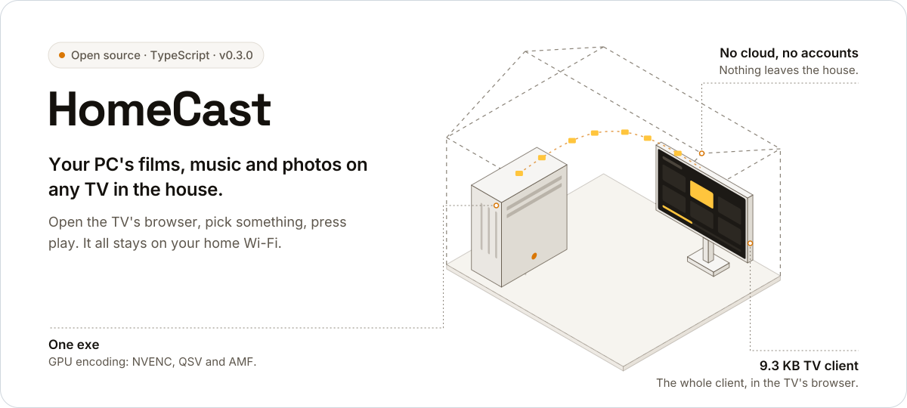
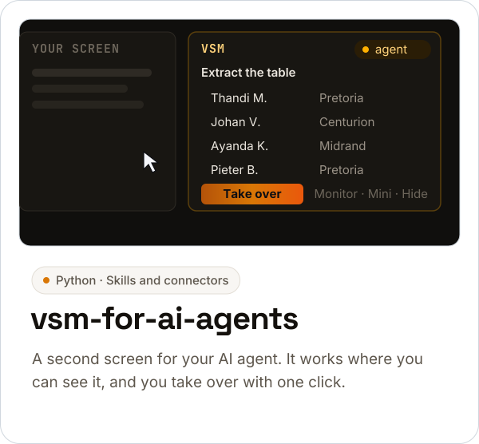
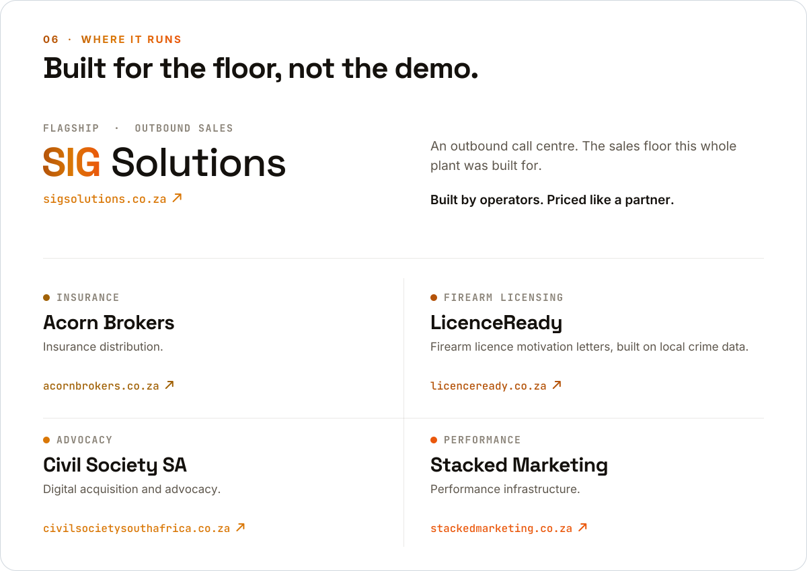

<picture><source media="(prefers-color-scheme: dark)" srcset="v10/generated/hero-dark.svg"><source media="(prefers-color-scheme: light)" srcset="v10/generated/hero-light.svg"></picture>

<picture><source media="(prefers-color-scheme: dark)" srcset="v10/generated/floor-dark.svg"><source media="(prefers-color-scheme: light)" srcset="v10/generated/floor-light.svg"></picture>

<picture><source media="(prefers-color-scheme: dark)" srcset="v10/generated/stack-dark.svg"><source media="(prefers-color-scheme: light)" srcset="v10/generated/stack-light.svg"></picture>

<picture><source media="(prefers-color-scheme: dark)" srcset="v10/generated/section-projects-dark.svg"><source media="(prefers-color-scheme: light)" srcset="v10/generated/section-projects-light.svg"></picture>

<a href="https://github.com/bully911210/homecast"><picture><source media="(prefers-color-scheme: dark)" srcset="v10/generated/homecast-dark.svg"><source media="(prefers-color-scheme: light)" srcset="v10/generated/homecast-light.svg"></picture></a>

<a href="https://github.com/bully911210/homecast/releases/latest/download/HomeCast-win-x64.zip"><picture><source media="(prefers-color-scheme: dark)" srcset="v10/generated/btn-homecast-dark.svg"><source media="(prefers-color-scheme: light)" srcset="v10/generated/btn-homecast-light.svg"></picture></a>

<a href="https://github.com/bully911210/claude-code-mods"><picture><source media="(prefers-color-scheme: dark)" srcset="v10/generated/claude-code-mods-dark.svg"><source media="(prefers-color-scheme: light)" srcset="v10/generated/claude-code-mods-light.svg"></picture></a>

<a href="https://bully911210.github.io/claude-code-mods/"><picture><source media="(prefers-color-scheme: dark)" srcset="v10/generated/btn-ccm-demo-dark.svg"><source media="(prefers-color-scheme: light)" srcset="v10/generated/btn-ccm-demo-light.svg"></picture></a>

<a href="https://github.com/bully911210/nanowall"><picture><source media="(prefers-color-scheme: dark)" srcset="v10/generated/nanowall-dark.svg"><source media="(prefers-color-scheme: light)" srcset="v10/generated/nanowall-light.svg"></picture></a> <a href="https://github.com/bully911210/vsm-for-ai-agents"><picture><source media="(prefers-color-scheme: dark)" srcset="v10/generated/vsm-for-ai-agents-dark.svg"><source media="(prefers-color-scheme: light)" srcset="v10/generated/vsm-for-ai-agents-light.svg"></picture></a>

<a href="https://github.com/bully911210/snipe-loop"><picture><source media="(prefers-color-scheme: dark)" srcset="v10/generated/snipe-loop-dark.svg"><source media="(prefers-color-scheme: light)" srcset="v10/generated/snipe-loop-light.svg"></picture></a>

<picture><source media="(prefers-color-scheme: dark)" srcset="v10/generated/receipts-dark.svg"><source media="(prefers-color-scheme: light)" srcset="v10/generated/receipts-light.svg"></picture>

<picture><source media="(prefers-color-scheme: dark)" srcset="v10/generated/where-it-runs-dark.svg"><source media="(prefers-color-scheme: light)" srcset="v10/generated/where-it-runs-light.svg"></picture>

<a href="https://sigsolutions.co.za">SIG Solutions</a> &nbsp;·&nbsp; <a href="https://acornbrokers.co.za">Acorn Brokers</a> &nbsp;·&nbsp; <a href="https://licenceready.co.za">LicenceReady</a> &nbsp;·&nbsp; <a href="https://civilsocietysouthafrica.co.za">Civil Society SA</a> &nbsp;·&nbsp; <a href="https://stackedmarketing.co.za">Stacked Marketing</a>

<picture><source media="(prefers-color-scheme: dark)" srcset="v10/generated/section-contact-dark.svg"><source media="(prefers-color-scheme: light)" srcset="v10/generated/section-contact-light.svg"></picture>

<a href="mailto:franz@sigsolutions.co.za"><picture><source media="(prefers-color-scheme: dark)" srcset="v10/generated/btn-email-dark.svg"><source media="(prefers-color-scheme: light)" srcset="v10/generated/btn-email-light.svg"></picture></a> <a href="https://linkedin.com/in/franzbadenhorst"><picture><source media="(prefers-color-scheme: dark)" srcset="v10/generated/btn-linkedin-dark.svg"><source media="(prefers-color-scheme: light)" srcset="v10/generated/btn-linkedin-light.svg"></picture></a> <a href="https://x.com/FranzSalesSense"><picture><source media="(prefers-color-scheme: dark)" srcset="v10/generated/btn-x-dark.svg"><source media="(prefers-color-scheme: light)" srcset="v10/generated/btn-x-light.svg"></picture></a>

